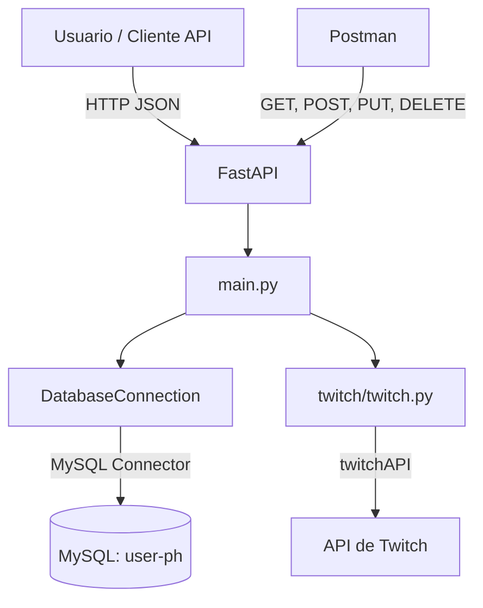
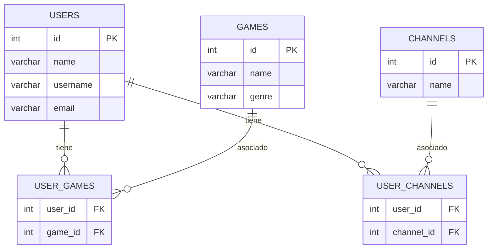

# 📘 API de Gestión de Usuarios y Juegos Favoritos

> API REST desarrollada con FastAPI que administra usuarios, sus juegos favoritos y consulta los streams en vivo de esos juegos en Twitch.

---

## 1. Información general

| Campo | Descripción |
|---|---|
| Nombre del proyecto | Tarea 1 Módulo 2 |
| Versión | 0.0.4 |
| Fecha de inicio | Viernes 20, noviembre, 26 |
| Última actualización | Martes 24, noviembre, 26 |
| Estado | Pruebas y ajustes finales - Fase 3 |
| Autor(es) | Bertha I. Garrastacho Reyes |
| Repositorio | https://github.com/berthagr/Modulo2MasterTarea1.git |

### 1.1. Descripción

El proyecto presenta una API desarrollada con FastAPI y Python. Permite registrar y administrar usuarios en MySQL, consultar el catálogo de juegos, asociar juegos favoritos a un usuario y obtener los streams en vivo de sus streamers favoritos desde la API de Twitch.

### 1.2. Objetivos

- Objetivo general: Gestionar información de usuarios y sus juegos favoritos, relacionándolos con los streams en vivo de la plataforma Twitch.
- Objetivos específicos:
  - Desarrollar un CRUD para gestionar los datos de los usuarios.
  - Consultar el catálogo de juegos, ordenado y agrupado por género.
  - Asociar juegos favoritos a cada usuario.
  - Conectar la API con la API de terceros de Twitch para obtener streams por juego.

### 1.3. Alcance del proyecto

**Incluye:**
- CRUD para gestionar datos de los usuarios: GET ALL, POST, PUT, DELETE.
- Registro de juegos favoritos por usuario.
- Listado de juegos ordenado por género y nombre, y agrupado por género.
- Consulta de los canales favoritos de un usuario con sus streams en vivo en Twitch.

**No incluye:**
- Autenticación de usuarios.
- Pruebas unitarias automatizadas.

---

## 2. Requisitos del proyecto

### 2.1. Requisitos funcionales

| ID | Requisito | Estado |
|---|---|---|
| RF-01 | CRUD de gestión de usuarios | Listo |
| RF-02 | Base de datos MySQL | Listo |
| RF-03 | Gestión de juegos favoritos por usuario | Listo |
| RF-04 | Consulta de streams en vivo de Twitch por juego | Listo |

## 3. Tecnologías y herramientas

### 3.1. Stack tecnológico

| Tecnología | Utilización |
|---|---|
| Python | Lenguaje del backend |
| FastAPI | Framework de la API REST |
| MySQL | Base de datos relacional |
| Pydantic | Validación de modelos de datos |
| twitchAPI | Cliente de la API de Twitch |

### 3.2. Herramientas utilizadas

- Editor de código: VSC
- Control de versiones: GIT - GITHUB
- Gestión de bases de datos: MySQL - dBeaver
- Testing: POSTMAN
- Despliegue: -
- Otras herramientas: CLAUDE

---

## 4. Arquitectura del proyecto

### 4.1. Descripción de la arquitectura

El proyecto utiliza una arquitectura en capas basada en cliente-servidor y una API REST.
El cliente de pruebas, Postman, envía solicitudes HTTP al backend desarrollado con FastAPI. El módulo principal `main.py` expone las rutas y controla las operaciones sobre usuarios, juegos y favoritos.

Las operaciones utilizan `DatabaseConnection` para establecer la conexión con MySQL y ejecutar consultas SQL con parámetros `%s`. Los modelos Pydantic `User`, `Genre` y `Games` validan y estructuran los datos antes de devolverlos. Para las consultas a Twitch, el módulo `twitch/twitch.py` utiliza `twitchAPI` para buscar la categoría de un juego y sus streams en vivo. Las variables de configuración sensibles se cargan desde el archivo `.env` mediante `python-dotenv`.

Durante la creación de la base de datos, se establecieron reglas para cada columna. Los campos obligatorios fueron definidos como `NOT NULL`, se configuró el identificador `id` como clave primaria y con incremento automático, y se definieron restricciones de longitud y formato para los datos de nombre, usuario y correo electrónico. Estas reglas garantizan la integridad de la información almacenada y complementan las validaciones realizadas por Pydantic antes de enviar los datos al servidor.

### 4.2. Diagrama de arquitectura



### 4.3. Estructura de directorios

```text
Modulo2MasterTarea1/
├── main.py                  # Aplicación FastAPI y rutas
├── config/
│   └── connections.py       # Gestión de la conexión a MySQL
├── database/
│   └── database.py          # Consultas SQL de usuarios, juegos y canales
├── models/
│   ├── modelUser.py         # Modelo Pydantic User
│   └── modelGenres.py       # Modelos Pydantic Genre y Games
├── services/
│   ├── users/users.py       # Lógica de usuarios y página principal
│   ├── games/games.py       # Lógica de juegos y favoritos de juegos
│   ├── channels/channel.py  # Lógica de canales y favoritos en vivo
│   └── twitch/twitch.py     # Consultas a la API de Twitch
├── docs/
│   └── readme.md            # Documentación del proyecto
├── docker-compose.yml       # Contenedor de MySQL
├── venv/                    # Entorno virtual de Python
├── .env                     # Variables privadas de conexión y de Twitch
└── .gitignore
```

### 4.4. Descripción de módulos

| Módulo | Responsabilidad | Descripción |
|---|---|---|
| `main.py` | Interfaz HTTP y operaciones | Inicializa FastAPI, muestra la página principal y gestiona las rutas de usuarios, juegos y favoritos. |
| `config/connections.py` | Conexión con la base de datos | Carga las variables de entorno y crea la conexión reutilizable mediante `mysql.connector`. |
| `models/modelUser.py` | Validación de datos | Define el modelo `User` y sus restricciones de nombre, usuario y correo electrónico con Pydantic. |
| `models/modelGenres.py` | Estructura de respuesta | Define `Games` (id y nombre de un juego) y `Genre` (género con su lista de juegos). |
| `services/users/users.py` | Lógica de usuarios | Consulta y modifica usuarios, y devuelve sus juegos y canales favoritos en `GET /users`. |
| `services/games/games.py` | Lógica de juegos | Catálogo de juegos, agrupación por género y favoritos de juegos. |
| `services/channels/channel.py` | Lógica de canales | Listado de canales, canales favoritos del usuario y canales favoritos en vivo. |
| `services/twitch/twitch.py` | Integración con Twitch | Busca la categoría de un juego, obtiene streams por juego y consulta qué canales (por login) están en vivo con `twitchAPI`. |
| `database/database.py` | Acceso a datos | Funciones SQL reutilizables para usuarios, juegos y canales. |
| `docs/readme.md` | Documentación técnica | Describe los objetivos, tecnologías, arquitectura, instalación y uso del proyecto. |
| `.env` | Configuración privada | Contiene los datos de conexión a MySQL y las credenciales de la aplicación de Twitch. |

---

## 5. Instalación y configuración

### 5.1. Requisitos previos

- Python 3.9 o una versión compatible.
- Entorno virtual de Python.
- MySQL Server o MySQL en ejecución.
- Cliente de MySQL, como dBeaver, MySQL Workbench o JetBrains DataGrip.
- Docker y Docker Compose, si se utiliza la configuración incluida para MySQL.
- Una aplicación registrada en la consola de desarrolladores de Twitch, para obtener el `Client ID` y el `Client Secret`.
- Git para clonar y gestionar el repositorio.
- Postman o un navegador para probar `/docs` y las rutas de la API.

### 5.2. Instalación

```bash
# Clonar el repositorio
git clone https://github.com/berthagr/Modulo2MasterTarea1.git

# Acceder al directorio
cd Modulo2MasterTarea1

# Crear y activar el entorno virtual
python3 -m venv venv
source venv/bin/activate

# Instalar dependencias
venv/bin/pip install fastapi "uvicorn[standard]" mysql-connector-python python-dotenv pydantic twitchAPI
```

### 5.2.1. Configuración de MySQL con Docker Compose

El proyecto incluye el archivo `docker-compose.yml`, que crea un contenedor MySQL mediante
Docker Compose:

```yaml
services:
  db:
    image: mysql:latest
    container_name: users-db
    restart: unless-stopped
    environment:
      MYSQL_ROOT_PASSWORD: 123
      MYSQL_DATABASE: user-ph
      MYSQL_USER: mysql
      MYSQL_PASSWORD: admin
    ports:
      - "3307:3306"
    volumes:
      - ./.db:/var/lib/mysql
```

Para iniciar el contenedor desde la raíz del proyecto:

```bash
docker compose up -d
```

Para comprobar que el contenedor está activo:

```bash
docker ps
```

Para detener los servicios:

```bash
docker compose down
```

Docker publica MySQL en el puerto local `3307`. Las variables de `.env` deben coincidir con
las credenciales definidas en `docker-compose.yml`. Si se utiliza el usuario `mysql`,
configurar:

```env
DB_HOST=127.0.0.1
DB_USER=mysql
DB_PASS=admin
DB_NAME=user-ph
DB_PORT=3306
```

### 5.3. Variables de entorno

Crear un archivo `.env` en la raíz del proyecto a partir de las siguientes variables:

```env
DB_HOST=127.0.0.1
DB_USER=root
DB_PASS=tu_contraseña
DB_NAME=user-ph
DB_PORT=3307
TWITCH_CLIENT_ID=tu_client_id
TWITCH_CLIENT_SECRET=tu_client_secret
```

| Variable | Descripción | Obligatoria |
|---|---|---|
| `DB_HOST` | Dirección del servidor MySQL | Sí |
| `DB_USER` | Usuario de MySQL | Sí |
| `DB_PASS` | Contraseña del usuario MySQL | Sí |
| `DB_NAME` | Nombre de la base de datos, por ejemplo `user-ph` | Sí |
| `DB_PORT` | Puerto de MySQL, por ejemplo `3306` o `3307` | Sí |
| `TWITCH_CLIENT_ID` | Client ID de la aplicación de Twitch | Sí, para las rutas de Twitch |
| `TWITCH_CLIENT_SECRET` | Client Secret de la aplicación de Twitch | Sí, para las rutas de Twitch |

La base de datos debe contener las tablas `users`, `games`,`channels`, `user_games` y `users_channels`, descritas en la sección 6.4.

### 5.4. Ejecución del servicio con uvicorn

La aplicación FastAPI está en el archivo `main.py`, en la variable `app`. Uvicorn es el servidor
que la ejecuta, así que el comando se escribe como `archivo:variable`, es decir, `main:app`.

**Antes de iniciar:**
1. Verificar que el contenedor de MySQL esté activo (`docker ps`).
2. Verificar que el archivo `.env` exista en la raíz del proyecto (sección 5.3).
3. Tener el entorno virtual activado, o usar la ruta `venv/bin/uvicorn` como en los ejemplos.

**Iniciar el servicio** desde la raíz del proyecto:

```bash
# Activar el entorno virtual (macOS / Linux)
source venv/bin/activate

# Levantar el servicio con recarga automática al guardar cambios
uvicorn main:app --reload --port 5001
```

Si no quieres activar el entorno, ejecuta el mismo comando con la ruta completa:

```bash
venv/bin/uvicorn main:app --reload --port 5001
```

En Windows, la ruta del ejecutable es `venv\Scripts\uvicorn`:

```bash
venv\Scripts\uvicorn main:app --reload --port 5001
```

**Opciones principales:**

| Opción | Descripción |
|---|---|
| `main:app` | Archivo `main.py` y objeto `app` que contiene la aplicación. |
| `--reload` | Reinicia el servicio automáticamente al cambiar código. Úsalo solo en desarrollo. |
| `--port 5001` | Puerto de escucha. Se usa `5001` porque en macOS el puerto `5000` lo ocupa AirDrop (sección 8.2). |
| `--host 127.0.0.1` | Dirección de escucha. Es el valor por defecto; usa `0.0.0.0` solo si necesitas acceder desde otro equipo. |

**Verificar que el servicio funciona:**

- Página principal: `http://127.0.0.1:5001/`
- Documentación interactiva (Swagger): `http://127.0.0.1:5001/docs`
- Lista de usuarios: `http://127.0.0.1:5001/users`

Para detener el servicio, presiona `Ctrl + C` en la terminal donde se está ejecutando.

**Problemas comunes al iniciar:**

| Síntoma | Causa probable | Solución |
|---|---|---|
| `command not found: uvicorn` | El entorno virtual no está activo o no se instalaron las dependencias. | Activar `venv` y ejecutar la instalación de la sección 5.2. |
| `Address already in use` | Otro proceso usa el puerto. | Cambiar el puerto (por ejemplo `--port 5002`) o detener el proceso anterior. |
| `ModuleNotFoundError` | Se ejecuta desde una carpeta distinta a la raíz del proyecto. | Ejecutar el comando desde la carpeta que contiene `main.py`. |
| Error 500 en `/users` | MySQL no está activo o `.env` tiene credenciales incorrectas. | Revisar `docker ps` y los valores de `DB_*` en `.env`. |
| Error 500 en rutas de Twitch | Faltan `TWITCH_CLIENT_ID` o `TWITCH_CLIENT_SECRET`, o no hay conexión a internet. | Revisar `.env` (sección 5.3). |

---

## 6. Implementación y desarrollo

### 6.1. Funcionalidades implementadas

| ID | Funcionalidad | Descripción | Estado |
|---|---|---|---|
| F-01 | Página principal | Presenta un encabezado, descripción y enlace a la documentación desde la ruta `/`. | Completada |
| F-02 | Consulta de usuarios | Permite obtener todos los registros almacenados mediante `GET /users`. | Completada |
| F-03 | Registro de usuarios | Permite insertar nombre, nombre de usuario y correo mediante `POST /users`. | Completada |
| F-04 | Actualización de usuarios | Permite modificar uno o varios datos mediante `PUT /users/{userph_id}`. | Completada |
| F-05 | Eliminación de usuarios | Permite eliminar un registro mediante `DELETE /users/{userph_id}`. | Completada |
| F-06 | Juegos favoritos | Permite asociar una lista de juegos a un usuario mediante `POST /users/{user_id}/games`. | Completada |
| F-07 | Catálogo de juegos | Lista los juegos ordenados por género y nombre (`GET /games`) o agrupados por género (`GET /games/genre`). | Completada |
| F-08 | Favoritos con streams de Twitch | Devuelve los juegos favoritos de un usuario con los streams en vivo de cada uno (`GET /user-fav-games/{user_id}`). | Completada |
| F-09 | Listado de canales | Lista los canales guardados en la tabla `channels` (`GET /channels`). | Completada |
| F-10 | Canales favoritos del usuario | Asocia canales a un usuario (`POST /user/{user_id}/channels`) y los consulta (`GET /user-fav-channels/{user_id}`). | Completada |
| F-11 | Usuarios con canales | `GET /users` incluye en cada usuario la lista `channels` con sus canales favoritos. | Completada |
| F-12 | Canales favoritos en vivo | Devuelve solo los canales favoritos del usuario que están transmitiendo en Twitch (`GET /user-fav-channels-ONLIVE/{user_id}`). | completada |

### 6.2. Descripción de los componentes principales

#### Componente 1: API FastAPI

- **Responsabilidad:** Exponer la aplicación web y los endpoints de usuarios, juegos y favoritos.
- **Entradas:** Solicitudes HTTP y datos JSON enviados por el cliente.
- **Salidas:** Respuestas JSON, páginas HTML y códigos de estado HTTP.
- **Dependencias:** FastAPI, `DatabaseConnection`, modelos Pydantic y el módulo `twitch`.
- **Observaciones:** Las rutas están organizadas en `main.py`.

#### Componente 2: Conexión a MySQL

- **Responsabilidad:** Crear y reutilizar la conexión con la base de datos.
- **Entradas:** Host, usuario, contraseña, puerto y nombre de base de datos.
- **Salidas:** Conexión de `mysql.connector` utilizada por los endpoints.
- **Dependencias:** `mysql-connector-python`, `python-dotenv` y variables del archivo `.env`.
- **Observaciones:** La conexión se inicializa una sola vez mediante `get_db_connection()`.

#### Componente 3: Integración con Twitch

- **Responsabilidad:** Buscar la categoría de un juego en Twitch, obtener sus streams en vivo y consultar si los canales favoritos del usuario están transmitiendo.
- **Entradas:** Nombre del juego.
- **Salidas:** Lista de streams (hasta 5 por juego).
- **Dependencias:** `twitchAPI` y las variables `TWITCH_CLIENT_ID` y `TWITCH_CLIENT_SECRET`.
- **Observaciones:** `get_top_streams_in_game()` abre y cierra una sesión de Twitch por cada juego consultado.

### 6.3. API y endpoints

| Método | Endpoint | Descripción | Parámetros |
|---|---|---|---|
| GET | `/` | Devuelve la página HTML principal. | Ninguno |
| GET | `/` | Devuelve la página HTML principal. | Ninguno |
| GET | `/users` | Lista los usuarios con sus juegos y canales favoritos. | Ninguno |
| POST | `/users` | Agrega un usuario. | Cuerpo JSON con `name`, `username`, `email` |
| PUT | `/users/{userph_id}` | Actualiza los campos enviados de un usuario. | `userph_id` y campos opcionales |
| DELETE | `/user/{userph_id}` | Elimina un usuario por identificador. Nota: la ruta usa `/user/` en singular, a diferencia de PUT. | `userph_id` |
| GET | `/games` | Lista los juegos ordenados por género y nombre. | Ninguno |
| GET | `/games/genre` | Lista los juegos agrupados por género. | Ninguno |
| GET | `/user-fav-games/{user_id}` | Devuelve los juegos favoritos del usuario con sus streams en vivo. **Pendiente: actualmente falla (ver 8.3).** | `user_id` |
| POST | `/user/{user_id}/games` | Agrega una lista de juegos a los favoritos del usuario. | `user_id` y cuerpo JSON `{"games": [id, ...]}` |
| GET | `/channels` | Lista los canales guardados. | Ninguno |
| POST | `/user/{user_id}/channels` | Agrega canales a los favoritos del usuario. Ignora los que ya existen. | `user_id` y cuerpo JSON `{"channels": [id, ...]}` |
| GET | `/user-fav-channels/{user_id}` | Devuelve los canales favoritos del usuario. | `user_id` |
| GET | `/user-fav-channels-ONLIVE/{user_id}` | Devuelve los canales favoritos del usuario que están en vivo en Twitch. | `user_id` |
| GET | `/docs` | Muestra la documentación interactiva Swagger. | Ninguno |

Ejemplo de cuerpo para `POST /users/{user_id}/games`:

```json
{
  "games": [2, 12, 10]
}
```

Ejemplo de cuerpo para `POST /user/{user_id}/channels`:

```json
{
  "channels": [1, 2, 3]
}
```

Ejemplo de respuesta de `GET /user-fav-channels-ONLIVE/{user_id}`:

```json
{
  "live": [
    {"channel": "ibai", "title": "...", "game": "Just Chatting", "viewers": 25000}
  ]
}
```
**NOTA IMPORTANTE:** Dentro de la carpeta de docs se encuentra el archivo ________ con todas las peticiones para testear la API. Se agregarán en el último commit.

### 6.4. Modelo de datos

La base de datos `user-ph` contiene cinco tablas: `users`, `games`, `channels` y las tablas de relación `user_games` y `user_channels`, que asocian usuarios con sus juegos y canales favoritos.

| Tabla | Columna | Tipo sugerido | Restricción |
|---|---|---|---|
| `users` | `id` | `INT` | Clave primaria y incremento automático |
| `users` | `name` | `VARCHAR(300)` | Obligatorio |
| `users` | `username` | `VARCHAR(100)` | Obligatorio |
| `users` | `email` | `VARCHAR(254)` | Obligatorio y formato de correo válido |
| `games` | `id` | `INT` | Clave primaria |
| `games` | `name` | `VARCHAR(...)` | Obligatorio |
| `games` | `genre` | `VARCHAR(...)` | Obligatorio |
| `user_games` | `user_id` | `INT` | Clave foránea hacia `users.id` |
| `user_games` | `game_id` | `INT` | Clave foránea hacia `games.id` |
| `channels` | `id` | `INT` | Clave primaria y incremento automático |
| `channels` | `name` | `VARCHAR(100)` | Obligatorio y único (necesario para `INSERT IGNORE`) |
| `user_channels` | `user_id` | `INT` | Clave foránea hacia `users.id`; forma clave primaria compuesta con `channel_id` |
| `user_channels` | `channel_id` | `INT` | Clave foránea hacia `channels.id` |


**NOTA IMPORTANTE:**: Se establecieron una cantidad fija de categorias de juegos, juegos y streamers, para tener unos valores de referencia fijos con los que testear.
---

## 7. Pruebas y validación

### 7.1. Estrategia de pruebas

Las pruebas principales se realizan manualmente desde Postman.

- [x] Pruebas funcionales
- [x] Pruebas de integración


### 7.2. Registro de pruebas

| ID | Prueba | Resultado esperado | Resultado obtenido | Estado |
|---|---|---|---|---|
| T-01 | `GET /users` | Devuelve la lista de usuarios almacenados. | Pendiente de registro formal | Completada |
| T-02 | `POST /users` | Inserta el registro y devuelve el identificador creado. | Se realizó correctamente después de ajustar las credenciales. | Completada |
| T-03 | `PUT /users/{id}` | Actualiza únicamente los campos enviados y conserva los demás. | Implementada; requiere validación final. | Completada |
| T-04 | `DELETE /users/{id}` | Elimina el registro y devuelve confirmación. | Implementada con parámetros seguros. | Completada |
| T-05 | Uso de credenciales incorrectas | La API debe evitar fallos silenciosos y registrar el motivo del error. | Se detectó una denegación de acceso con MySQL. | Completada |
| T-06 | `POST /users/{user_id}/games` | Inserta una fila por juego en `user_games` y devuelve el número de filas insertadas. | Implementada; requiere validación. | Completada |
| T-07 | `GET /games` y `GET /games/genre` | Devuelven el catálogo ordenado y agrupado por género. | Implementadas; requieren validación. | Completada |
| T-08 | `GET /user-fav-games/{user_id}` | Devuelve los favoritos del usuario con sus streams. | Implementada; presenta problemas conocidos (ver 8.3). | Pendiente a correcciones |
| T-09 | `GET /channels` | Devuelve los canales guardados en `channels`. | Pendiente de validación. | Pendiente |
| T-10 | `POST /user/{user_id}/channels` | Inserta filas en `user_channels` e ignora duplicados. | Pendiente de validación. | Pendiente |
| T-11 | `GET /user-fav-channels/{user_id}` | Devuelve los canales favoritos del usuario. | Pendiente de validación. | Pendiente |
| T-12 | `GET /user-fav-channels-ONLIVE/{user_id}` | Devuelve solo los canales favoritos que están en vivo. | Se corrigió el orden de argumentos de la ruta; pendiente de validación con credenciales reales. | Pendiente |
| T-13 | `GET /users` con canales | Cada usuario incluye la lista `channels`. | Pendiente de validación. | Pendiente |

---

## 8. Observaciones y decisiones técnicas

### 8.1. Observaciones generales

- FastAPI genera automáticamente la documentación OpenAPI en `/docs`.
- Para MacOS no se recomienda testear con el puerto 5000 en ordenadores MacOS ya que es usado por AirDrop.
- MySQL funciona desde Docker Compose en el puerto externo `3307` por tener varias instancias levantadas previamente pero se recomienda usar la `3306`.
- Las rutas de Twitch requieren una conexión a internet y credenciales válidas en `.env`.

### 8.2. Decisiones técnicas

| Fecha | Decisión | Justificación | Impacto |
|---|---|---|---|
| 20/11/2026 | Utilizar puerto 5001 | Para MacOS no se recomienda testear con el puerto 5000 ya que es usado por AirDrop. | Es un servicio critico del ecosistema de apple |
| 20/11/2026 | Usar Docker Compose | Facilita reproducir el servidor MySQL con puerto y credenciales conocidos. | Simplifica el entorno de desarrollo. |
| 23/11/2026 | Relacionar favoritos mediante la tabla `user_games` | Un usuario puede tener varios juegos y un juego puede pertenecer a varios usuarios; una tabla intermedia representa esa relación de muchos a muchos. | Permite agregar varios favoritos en una sola operación. |
| 23/11/2026 | Buscar streams por nombre de juego en Twitch | Permite obtener streams sin guardar en la base de datos los identificadores de categoría de Twitch. | Cada consulta hace una búsqueda de categoría adicional en Twitch. |
| 24/11/2026 | Relacionar canales favoritos mediante la tabla `user_channels` | Igual que con los juegos, un usuario puede tener varios canales y un canal puede pertenecer a varios usuarios. | Requiere crear las tablas `channels` y `user_channels`. |
| 24/11/2026 | Consultar canales en vivo por login con `get_streams(user_login=...)` en lotes de 100 | Evita una consulta por canal y respeta el límite de la API de Twitch. | Los nombres guardados deben coincidir con el login de Twitch. |
| 24/11/2026 | Usar `INSERT IGNORE` para los favoritos de canales | Evita errores al repetir una relación ya guardada. | Requiere clave primaria compuesta `(user_id, channel_id)`. |

### 8.3. Problemas y limitaciones

- **Problema: lista vacía en `POST /users/{user_id}/games`**
  - **Descripción:** La ruta no valida que `games` tenga elementos ni que el usuario y los juegos existan.
  - **Impacto:** Puede responder con error de base de datos o insertar filas con identificadores inválidos.
  - **Posible solución:** Validar la lista con un 400 y comprobar la existencia de los identificadores.
(CORREGIR)

(CORREGIR)
- **Problema: nombres de canales frente a logins de Twitch**
  - **Descripción:** Twitch identifica los canales por su login en minúsculas. Un nombre con caracteres no latinos o diferente al login no encuentra el canal.
  - **Impacto:** Un canal favorito puede no aparecer en `ONLIVE` aunque esté en vivo.
  - **Posible solución:** Guardar el login de Twitch en `channels`.
(ANALIZAR)

### 8.4. Aspectos pendientes

- [X] Validar todos los endpoints con datos existentes e inexistentes y probar casos extremos.
- [ ] Mover las credenciales de MySQL de `main.py` a `.env`.

---

## 9. Mejoras y trabajo futuro

| ID | Mejora propuesta | Prioridad | Complejidad | Estado |
|---|---|---|---|---|
| M-01 | Agregar autenticación mediante API key o JWT | Alta | Media | Pendiente |
| M-02 | Implementar paginación en `GET /users` | Media | Baja | Pendiente |
| M-03 | Reutilizar una sola sesión de Twitch en lugar de abrir una por juego | Media | Baja | Pendiente |

### 9.1. Recomendaciones

---

## 10. Conclusiones

### 10.1. Resultados obtenidos

El proyecto permite iniciar una API REST con FastAPI y ejecutar operaciones CRUD sobre usuarios almacenados en MySQL. También permite asociar juegos favoritos a cada usuario, consultar el catálogo de juegos y preparar la consulta de streams en vivo en Twitch. Incluye una página HTML básica, documentación, configuración mediante variables de entorno y un contenedor Docker para la base de datos.

### 10.2. Valoración técnica

FastAPI proporciona una estructura clara y documentación automática. MySQL permite representar los datos de forma relacionada, la tabla `user_games` resuelve la relación entre usuarios y juegos, y Docker Compose facilita la instalación de la base de datos.
La mantenibilidad puede mejorar al separar rutas, servicios y acceso a datos en módulos adicionales.

### 10.3. Dificultades encontradas

Las dificultades principales estuvieron relacionadas con las credenciales de MySQL, el puerto del contenedor y las conexiones fallidas. También se detectaron errores por consultas SQL interpoladas, llamadas incorrectas al cursor y el paso de listas como un solo parámetro. Estas dificultades se resolvieron utilizando parámetros `%s` (uno por cada valor cuando se trabaja con listas), variables de entorno y la configuración correcta de Docker Compose.

### 10.4. Conclusión final

El proyecto cumple el objetivo principal de administrar datos de usuarios mediante un CRUD y avanza en la relación con los juegos favoritos. El funcionamiento básico está implementado, aunque la consulta de favoritos con streams de Twitch requiere correcciones, y el proyecto todavía necesita pruebas automatizadas y mejoras de seguridad y mantenimiento.

---

## 11. Control de versiones y cambios

| Versión | Fecha | Autor | Descripción de los cambios |
|---|---|---|---|
| 0.0.1 | 20/11/2026 | Bertha I. Garrastacho Reyes | Creación inicial de FastAPI y ruta principal |
| 0.0.2 | 21/11/2026 | Bertha I. Garrastacho Reyes | Implementación de CRUD, MySQL, Docker Compose y documentación técnica |
| 0.0.3 | 23/11/2026 | Bertha I. Garrastacho Reyes | Modelos de usuarios, juegos y géneros; rutas de juegos favoritos y catálogo de juegos; integración inicial con la API de Twitch; actualización de la documentación |
| 0.0.4 | 24/11/2026 | Bertha I. Garrastacho Reyes | Canales: tablas `channels` y `user_channels`, rutas de canales favoritos, consulta de canales en vivo en Twitch y `GET /users` con canales; código reorganizado en `services/` y `database/`; actualización de la documentación |

---

## 12. Referencias y recursos

- [Documentación oficial de FastAPI](https://fastapi.tiangolo.com/)
- [Documentación oficial de Pydantic](https://docs.pydantic.dev/)
- [Documentación oficial de MySQL Connector/Python](https://dev.mysql.com/doc/connector-python/en/)
- [Documentación oficial de Docker Compose](https://docs.docker.com/compose/)
- [Documentación oficial de python-dotenv](https://saurabh-kumar.com/python-dotenv/)
- [Documentación oficial de OpenAPI](https://swagger.io/specification/)
- [Documentación de twitchAPI](https://twitchapi.readthedocs.io/)
- [Documentación de la API de Twitch](https://dev.twitch.tv/docs/api/)

---

## 13. Declaración de uso de herramientas de IA

Este proyecto se desarrolló con apoyo de un asistente de IA (Claude, de Anthropic), utilizado desde Claude Code en la terminal.

**Para qué se utilizó:**
- Proponer refactorizaciones, como la separación en servicios y la consulta de canales en vivo por lotes.
- Redactar y actualizar esta documentación, incluidas las tablas de endpoints, el modelo de datos y los problemas conocidos.
- Generar scripts SQL para cargar datos de canales.
- Consultar fuentes públicas para obtener información de empleo y uso de Twitch.

**Límites de la verificación:**
- La lista de canales populares se obtuvo de una tabla pública de Wikipedia y de los streams en vivo del momento de la consulta. No representa un ranking oficial de Twitch.

**Responsabilidad:** la autora es responsable del contenido, del comportamiento del código y de la documentación entregada.
---

**Última actualización:** 24/11/2026
