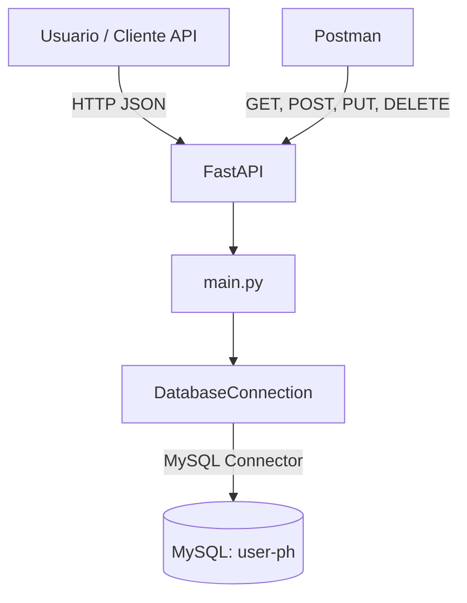
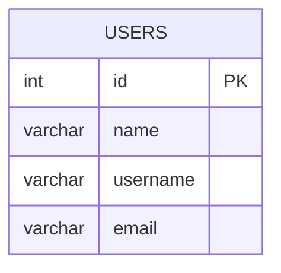

# 📘 Nombre del proyecto

> Descripción breve del proyecto y su propósito.

---

## 1. Información general

| Campo | Descripción |
|---|---|
| Nombre del proyecto | Tarea 1 Módulo 2 |
| Versión | 0.0.1|
| Fecha de inicio | Viernes 20, noviembre, 26|
| Última actualización | Sábado 21, noviembre, 26|
| Estado | En desarrollo - Fase 2|
| Autor(es) | Bertha I.Garrastacho Reyes |
| Repositorio | https://github.com/berthagr/Modulo2MasterTarea1.git |

### 1.1. Descripción

El proyecto presenta API desarrollada con FastAPI y Python. 

### 1.2. Objetivos

- Objetivo general: Gestionar información de Fotógrafos y sus preferencias en la plataforma social de Twitch
- Objetivos específicos:
  - Desarrollar un CRUD para gestionar datos de los fotógrafos
  - Conexión a la API de terceros de Twitch
  - Desarrollar un CRUD para gestionar preferencias de los fotógrafos

### 1.3. Alcance del proyecto

**Incluye:**
- CRUD para gestionar datos de los fotógrafos. GET ALL, GET By NAME, POST, PUT, DELETE

**No incluye:**
- 

---

## 2. Requisitos del proyecto

### 2.1. Requisitos funcionales

| ID | Requisito | Estado |
|---|---|---|---|
| RF-01 |CRUD de Gestion| Listo |
| RF-02 | Base de Datos | Listo |
| RF-03 | CRUD de gestión de preferencias| Pendiente |

## 3. Tecnologías y herramientas

### 3.1. Stack tecnológico

| Tecnología | Utilización |
|---|---|
| PYTHON| CRUD|
| MySQL| GDB|

### 3.2. Herramientas utilizadas

- Editor de código: VSC
- Control de versiones: GIT- GITHUB
- Gestión de bases de datos: MySQL - dBeaver
- Testing: POSTMAN
- Despliegue: - 
- Otras herramientas: CLAUDE


## 4. Arquitectura del proyecto

### 4.1. Descripción de la arquitectura

El proyecto utiliza una arquitectura en capas basada en cliente-servidor y una API REST.
El cliente de pruebas,  Postman, envía solicitudes HTTP al backend desarrollado con FastAPI. El módulo principal `main.py` expone las rutas y controla las operaciones CRUD.

Las operaciones utilizan `DatabaseConnection` para establecer la conexión con MySQL y ejecutar consultas SQL. El modelo `Photograper`, definido con Pydantic, valida los datos del fotógrafo antes de procesarlos. Las variables de configuración sensibles se cargan desde el archivo `.env`
mediante `python-dotenv`.

Durante la creación de la base de datos, se establecieron reglas para cada columna. Los campos obligatorios fueron definidos como `NOT NULL`, se configuró el identificador `id` como clave primaria y con incremento automático, y se definieron restricciones de longitud y formato para
los datos de nombre, usuario y correo electrónico. Estas reglas garantizan la integridad de la información almacenada y complementan las validaciones realizadas por Pydantic antes de enviar los datos al servidor.


### 4.2. Diagrama de arquitectura



### 4.3. Estructura de directorios

```text
Modulo2MasterTarea1/
├── main.py                  # Aplicación FastAPI y rutas CRUD
├── config/
│   └── connections.py       # Gestión de la conexión a MySQL
├── models/
│   └── modelPH.py           # Modelo Pydantic de fotógrafos
├── docs/
│   └── readme.md            # Documentación del proyecto
├── docker-compose.yml       # Contenedor de MySQL
├── venv/                    # Entorno virtual de Python
├── .env                     # Variables privadas de conexión
├── .env.template            # Plantilla de variables de entorno
└── .gitignore
```

### 4.4. Descripción de módulos

| Módulo | Responsabilidad | Descripción |
|---|---|---|
| `main.py` | Interfaz HTTP y operaciones CRUD | Inicializa FastAPI, muestra la página principal y gestiona las rutas para consultar, agregar, actualizar y eliminar fotógrafos. |
| `config/connections.py` | Conexión con la base de datos | Carga las variables de entorno y crea la conexión reutilizable mediante `mysql.connector`. |
| `models/modelPH.py` | Validación de datos | Define el modelo `Photograper` y sus restricciones de nombre, usuario y correo electrónico con Pydantic. |
| `media/camera-icon.svg` | Recurso visual | Contiene el icono gráfico utilizado por la interfaz web. |
| `docs/readme.md` | Documentación técnica | Describe los objetivos, tecnologías, arquitectura, instalación y uso del proyecto. |
| `.env` | Configuración privada | Contiene el host, usuario, contraseña, puerto y nombre de la base de datos. |

---

## 5. Instalación y configuración

### 5.1. Requisitos previos

- Python 3.9 o una versión compatible.
- Entorno virtual de Python.
- MySQL Server o MySQL en ejecución.
- Cliente de MySQL, como dBeaver,  MySQL Workbench o JetBrain Datagrid.
- Docker y Docker Compose, si se utiliza la configuración incluida para MySQL.
- Git para clonar y gestionar el repositorio.
- Postman o un navegador para probar `/docs` y las rutas CRUD.

### 5.2. Instalación

```bash
# Clonar el repositorio
git clone https://github.com/berthagr/Modulo2MasterTarea1.git

# Acceder al directorio
cd Modulo2MasterTarea1

# Crear y activar el entorno virtual
python3 -m venv venv
source venv/bin/activate

# Instalar dependencias
venv/bin/pip install fastapi "uvicorn[standard]" mysql-connector-python python-dotenv pydantic
```

### 5.2.1. Configuración de MySQL con Docker Compose

El proyecto incluye el archivo `docker-compose.yml`, que crea un contenedor MySQL mediante
Docker Compose:

```yaml
services:
  db:
    image: mysql:latest
    container_name: users-db
    restart: unless-stopped
    environment:
      MYSQL_ROOT_PASSWORD: 123
      MYSQL_DATABASE: user-ph
      MYSQL_USER: mysql
      MYSQL_PASSWORD: admin
    ports:
      - "3307:3306"
    volumes:
      - ./.db:/var/lib/mysql
```

Para iniciar el contenedor desde la raíz del proyecto:

```bash
docker compose up -d
```

Para comprobar que el contenedor está activo:

```bash
docker ps
```

Para detener los servicios:

```bash
docker compose down
```

Docker publica MySQL en el puerto local `3307`. Las variables de `.env` deben coincidir con
las credenciales definidas en `docker-compose.yml`. Si se utiliza el usuario `mysql`,
configurar:

```env
DB_HOST=127.0.0.1
DB_USER=mysql
DB_PASS=admin
DB_NAME=user-ph
DB_PORT=3306
```

### 5.3. Variables de entorno

Crear un archivo `.env` en la raíz del proyecto a partir de las siguientes variables:

```env
DB_HOST=127.0.0.1
DB_USER=root
DB_PASS=tu_contraseña
DB_NAME=user-ph
DB_PORT=3307
```

| Variable | Descripción | Obligatoria |
|---|---|---|
| `DB_HOST` | Dirección del servidor MySQL | Sí |
| `DB_USER` | Usuario de MySQL | Sí |
| `DB_PASS` | Contraseña del usuario MySQL | Sí |
| `DB_NAME` | Nombre de la base de datos, por ejemplo `user-ph` | Sí |
| `DB_PORT` | Puerto de MySQL, por ejemplo `3306` o `3307` | Sí |

La base de datos debe contener una tabla llamada `users` con las columnas `id`,
`name`, `username` y `email`.

### 5.4. Ejecución del proyecto

```bash
# Desde la raíz del proyecto
venv/bin/uvicorn main:app --reload --port 5000
```

La API estará disponible en `http://127.0.0.1:5000`. La documentación interactiva de FastAPI
puede consultarse en `http://127.0.0.1:5000/docs`.

---

## 6. Implementación y desarrollo

### 6.1. Funcionalidades implementadas

| ID | Funcionalidad | Descripción | Estado |
|---|---|---|---|
| F-01 | Página principal | Presenta un encabezado, descripción e icono de cámara desde la ruta `/`. | Completada |
| F-02 | Consulta de fotógrafos | Permite obtener todos los registros almacenados mediante `GET /users`. | Completada |
| F-03 | Registro de fotógrafos | Permite insertar nombre, nombre de usuario y correo mediante `POST /users`. | Completada |
| F-04 | Actualización de fotógrafos | Permite modificar uno o varios datos mediante `PUT /users/{id}`. | Completada |
| F-05 | Eliminación de fotógrafos | Permite eliminar un registro mediante `DELETE /users/{id}`. | Completada |
| F-06 | Gestión de preferencias de Twitch | Conectar preferencias de fotógrafos con los recursos de Twitch. | Pendiente |

### 6.2. Descripción de los componentes principales

#### Componente 1: API FastAPI

- **Responsabilidad:** Exponer la aplicación web y los endpoints CRUD.
- **Entradas:** Solicitudes HTTP y datos JSON enviados por el cliente.
- **Salidas:** Respuestas JSON, páginas HTML y códigos de estado HTTP.
- **Dependencias:** FastAPI y `DatabaseConnection`.
- **Observaciones:** Las rutas están organizadas en `main.py`.

#### Componente 2: Conexión a MySQL

- **Responsabilidad:** Crear y reutilizar la conexión con la base de datos.
- **Entradas:** Host, usuario, contraseña, puerto y nombre de base de datos.
- **Salidas:** Conexión de `mysql.connector` utilizada por los endpoints.
- **Dependencias:** `mysql-connector-python`, `python-dotenv` y variables del archivo `.env`.
- **Observaciones:** La conexión se inicializa una sola vez mediante `get_db_connection()`.

### 6.3. API y endpoints

| Método | Endpoint | Descripción | Parámetros |
|---|---|---|---|
| GET | `/` | Devuelve la página HTML principal. | Ninguno |
| GET | `/users` | Lista todos los fotógrafos registrados. | Ninguno |
| POST | `/users` | Agrega un fotógrafo. | `name`, `username`, `email` |
| PUT | `/users/{userph_id}` | Actualiza los campos enviados de un fotógrafo. | `userph_id` y campos opcionales |
| DELETE | `/users/{userph_id}` | Elimina un fotógrafo por identificador. | `userph_id` |
| GET | `/docs` | Muestra la documentación interactiva Swagger. | Ninguno |

### 6.4. Modelo de datos

La base de datos `user-ph` contiene inicialmente la entidad `users`. Cada fotógrafo
se identifica mediante un campo `id` único y se registran su nombre, nombre de usuario y correo.

| Columna | Tipo sugerido | Restricción |
|---|---|---|
| `id` | `INT` | Clave primaria y incremento automático |
| `name` | `VARCHAR(300)` | Obligatorio |
| `username` | `VARCHAR(100)` | Obligatorio |
| `email` | `VARCHAR(254)` | Obligatorio y formato de correo válido |



---

## 7. Pruebas y validación

### 7.1. Estrategia de pruebas

Las pruebas principales se realizaron manualmente desde Swagger UI y Postman.

- [x] Pruebas funcionales
- [x] Pruebas de integración
- [ ] Pruebas unitarias automatizadas
- [ ] Pruebas de aceptación formalizadas
- [ ] Pruebas de rendimiento
- [ ] Pruebas de seguridad automatizadas

### 7.2. Registro de pruebas

| ID | Prueba | Resultado esperado | Resultado obtenido | Estado |
|---|---|---|---|---|
| T-01 | `GET /users` | Devuelve la lista de fotógrafos almacenados. | Pendiente de registro formal | Por ejecutar |
| T-02 | `POST /users` | Inserta el registro y devuelve el identificador creado. | Se realizó correctamente después de ajustar las credenciales. | Completada |
| T-03 | `PUT /users/{id}` | Actualiza únicamente los campos enviados y conserva los demás. | Implementada; requiere validación final. | Por validar |
| T-04 | `DELETE /users/{id}` | Elimina el registro y devuelve confirmación. | Implementada con parámetros seguros. | Por validar |
| T-05 | Uso de credenciales incorrectas | La API debe evitar fallos silenciosos y registrar el motivo del error. | Se detectó una denegación de acceso con MySQL. | Completada |

---

## 8. Observaciones y decisiones técnicas

### 8.1. Observaciones generales

- FastAPI genera automáticamente la documentación OpenAPI en `/docs`.
- Para MacOS no se recomienta testear con el pueto 5000 ya que es usado por Airdrop
- MySQL funciona desde Docker Compose en el puerto externo `3307`.

### 8.2. Decisiones técnicas

| Fecha | Decisión | Justificación | Impacto |
|---|---|---|---|
| 20/11/2026 | Utilizar puerto 5001 | 
| 20/11/2026 | Usar Docker Compose | Facilita reproducir el servidor MySQL con puerto y credenciales conocidos. | Simplifica el entorno de desarrollo. |

### 8.3. Problemas y limitaciones

- **Problema: configuración de credenciales**
  - **Descripción:** Las credenciales y el puerto deben coincidir entre `.env`, Docker Compose y MySQL.
  - **Impacto:** Una diferencia produce errores de acceso o tiempo de espera.
  - **Posible solución:** Mantener una plantilla `.env.template` completa y validar la conexión al iniciar.

### 8.4. Aspectos pendientes

- [ ] Implementar el módulo de preferencias de Twitch.
- [ ] Validar todos los endpoints con datos existentes e inexistentes y probar casos extremos.

---

## 9. Mejoras y trabajo futuro

| ID | Mejora propuesta | Prioridad | Complejidad | Estado |
|---|---|---|---|---|
| M-01 | Agregar autenticación mediante API key o JWT | Alta | Media | Pendiente |
| M-02 | Implementar paginación en `GET /users` | Media | Baja | Pendiente |
| M-03 | Agregar filtros por nombre, usuario o correo | Media | Baja | Pendiente |
| M-06 | Integrar preferencias y datos desde la API de Twitch | Alta | Alta | Pendiente |

### 9.1. Recomendaciones

---

## 10. Conclusiones

### 10.1. Resultados obtenidos

El proyecto permite iniciar una API REST con FastAPI y ejecutar operaciones CRUD sobre fotógrafos almacenados en MySQL. También incluye una interfaz HTML básica, documentación, configuración mediante variables de entorno y un contenedor Docker para la base de datos.

### 10.2. Valoración técnica

FastAPI proporciona una estructura clara y documentación automática. MySQL permite representar los datos de forma relacionada y Docker Compose facilita la instalación de la base de datos.
La mantenibilidad puede mejorar al separar rutas, servicios y acceso a datos en módulos adicionales.

### 10.3. Dificultades encontradas

Las dificultades principales estuvieron relacionadas con las credenciales de MySQL, el puerto del contenedor y las conexiones fallidas. También se detectaron errores por consultas SQL interpoladas y llamadas incorrectas al cursor. Estas dificultades se resolvieron utilizando parámetros `%s`, variables de entorno y la configuración correcta de Docker Compose.


### 10.4. Conclusión final

El proyecto cumple el objetivo principal de administrar datos de fotógrafos mediante un CRUD.
El funcionamiento básico está implementado, aunque todavía requiere pruebas automatizadas, una integración completa con preferencias de Twitch y mejoras de seguridad y mantenimiento.

---

## 11. Control de versiones y cambios

| Versión | Fecha | Autor | Descripción de los cambios |
|---|---|---|---|
| 0.0.1 | 20/11/2026 | Bertha I. Garrastacho Reyes | Creación inicial de FastAPI y ruta principal |
| 0.0.2 | 21/11/2026 | Bertha I. Garrastacho Reyes | Implementación de CRUD, MySQL, Docker Compose y documentación técnica |

---

## 12. Referencias y recursos

- [Documentación oficial de FastAPI](https://fastapi.tiangolo.com/)
- [Documentación oficial de Pydantic](https://docs.pydantic.dev/)
- [Documentación oficial de MySQL Connector/Python](https://dev.mysql.com/doc/connector-python/en/)
- [Documentación oficial de Docker Compose](https://docs.docker.com/compose/)
- [Documentación oficial de python-dotenv](https://saurabh-kumar.com/python-dotenv/)
- [Documentación oficial de OpenAPI](https://swagger.io/specification/)
---


**Última actualización:** 21/11/2026
